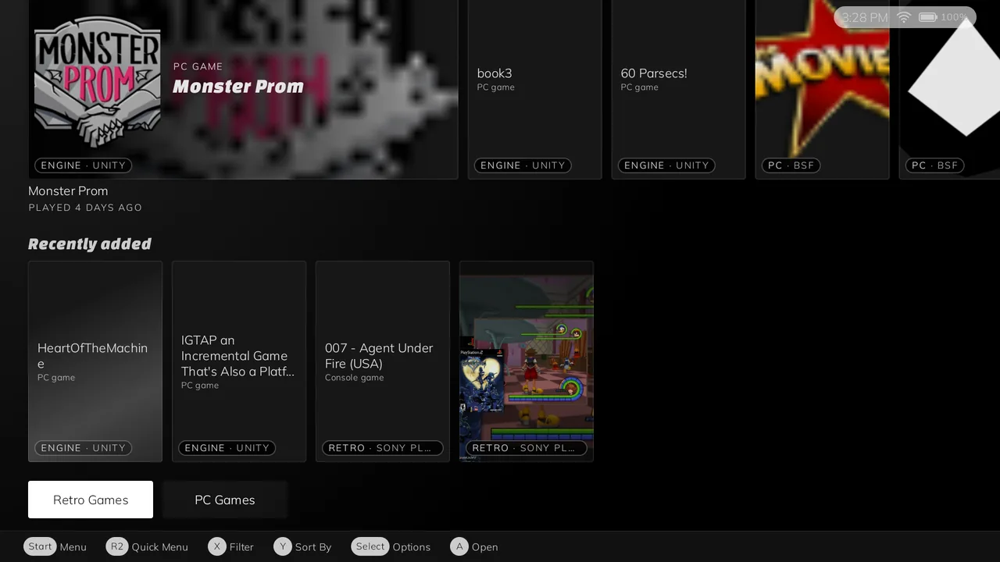
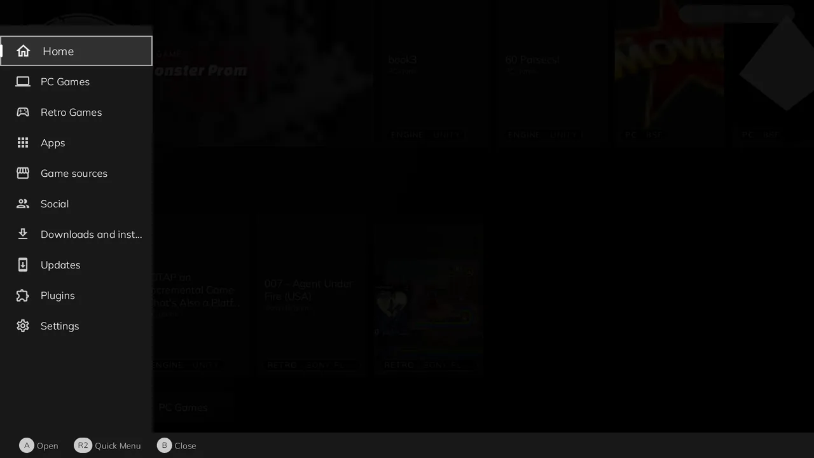
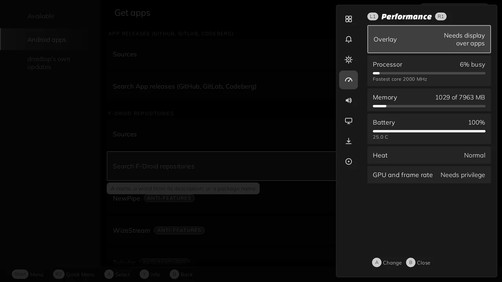
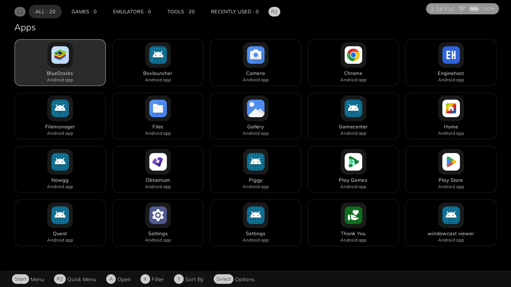
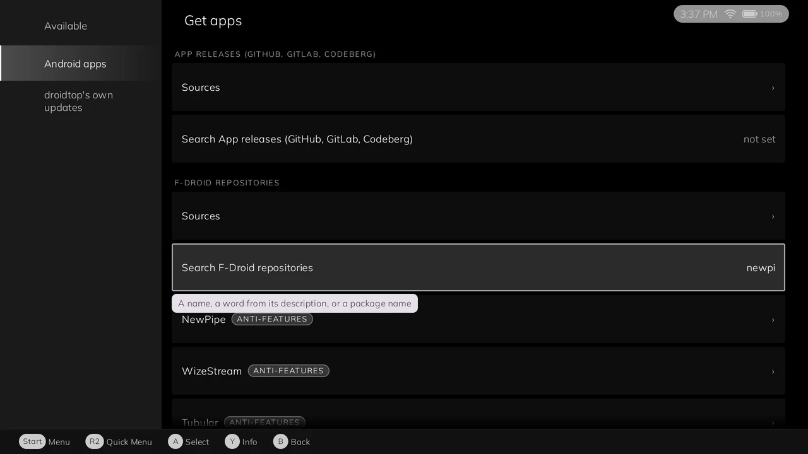

<h1 align="center">droidtop</h1>

<p align="center">
  <b>One library, three ways to use your Android handheld.</b><br>
  A gaming shell that wears real ES-DE themes, a standard home screen, and a desktop mode, all reading the same game list.
</p>

<p align="center">
  <a href="https://github.com/Droidtop/droidtop/releases"></a>
  <a href="https://github.com/Droidtop/droidtop/actions/workflows/android-build.yml"></a>
  <a href="https://github.com/Droidtop/droidtop/actions/workflows/android-checks.yml"></a>
  
  <a href="LICENSE"></a>
  
</p>

<p align="center">
  
</p>

<p align="center">
  <a href="#features">Features</a> ·
  <a href="#install">Install</a> ·
  <a href="#gallery">Gallery</a> ·
  <a href="#where-games-come-from">Games</a> ·
  <a href="#plugins">Plugins</a> ·
  <a href="#status">Status</a> ·
  <a href="#faq">FAQ</a> ·
  <a href="#build-from-source">Build</a> ·
  <a href="#credits-and-licence">Licence</a>
</p>

droidtop is a launcher and frontend for Android handhelds, developed and tested on the Retroid Pocket 5. It is one app with three modes, and each mode can be switched off. Every mode reads the same library: Android apps, console ROMs, PC games from the stores and from loose folders, and engine games such as Ren'Py, RPG Maker and KiriKiri.

## Features

| | |
|---|---|
| **Gaming** | A gamepad-driven shell that renders real ES-DE themes with droidtop's own theme engine. Start opens the menu, R2 opens the Quick Menu, L1 and R1 switch tabs. Two themes ship with it: DEcaffe for landscape and Slate for portrait. |
| **Launcher** | A standard Android home screen, shown as "Android" in the mode switcher. It is a fork of Murine Launcher, itself a fork of AOSP Launcher3, and is on when droidtop holds the HOME role. |
| **Desktop** | A taskbar and start menu around a Linux container's desktop, with container management. See [Status](#status) for how much works today. |
| **One library** | Apps, ROMs, PC games and engine games in one list, with ES-DE style artwork and metadata, filters, search and recently played. |
| **Second screen** | A companion screen for a second display that follows the mode you are in. |
| **Self-updating** | Updates itself from signed builds on a channel you pick. It sends nothing about your device. |

A mode that is switched off runs no code. Turning Gaming off does not stop games from launching, because the library, launching, settings, the updater and crash reporting belong to no single mode.

## Install

You need a handheld or phone on Android 8.0 or newer with an arm64-v8a or x86_64 processor.

1. Open [Releases](https://github.com/Droidtop/droidtop/releases) on the device and pick the newest build.
2. Download `droidtop.apk`.
3. Open the file. Android asks you to allow installs from your browser or file manager; allow it for this install.
4. Start droidtop and follow the first-run steps.

Later builds install over the first, by hand or through **Settings > Software updates**, because every APK is signed with the same key.

`droidtop-debug.apk` is the same code built debuggable, for inspecting with adb. It is several times slower to start and to navigate, so most people want `droidtop.apk`. `release-info.json` carries the version code, the file names, their SHA-256 digests and the commit.

Engine games run in [Enginehost](https://github.com/Droidtop/enginehost), a separate app that droidtop launches for you. Install it if you play Ren'Py, RPG Maker or similar games.

### Updates

| Channel | What it follows |
|---|---|
| Unstable (default) | The newest per-build release, one per push to `main`. |
| Testing | The `testing` release, published by hand. |
| Stable | The `stable` release, published by hand. |

A channel that has not been published yet reports that there is nothing there. The schedule is never, daily (default), weekly or monthly, with an option to check only on unmetered networks. The updater checks each download against its published SHA-256 and hands the APK to Android's installer, which shows its own confirmation. Every build keeps its own release, so the release list is the build history, and [CHANGELOG.md](CHANGELOG.md) covers numbered versions.

## Gallery

<table>
  <tr>
    <td width="50%" valign="top">
      
      <br><sub><b>Start menu.</b> Everything one press away.</sub>
    </td>
    <td width="50%" valign="top">
      
      <br><sub><b>Quick Menu.</b> Display, volume, performance and more, on R2.</sub>
    </td>
  </tr>
  <tr>
    <td width="50%" valign="top">
      
      <br><sub><b>Apps.</b> Your installed apps, sorted into tabs.</sub>
    </td>
    <td width="50%" valign="top">
      
      <br><sub><b>Get apps.</b> Search F-Droid and app-release catalogs, from a plugin.</sub>
    </td>
  </tr>
</table>

Screenshots are from an emulator running a recent build, with a test library.

## Where games come from

All sources feed one library model:

- **Android apps.**
- **Console ROMs.** Read from ES-DE's `<root>/<system>/<rom>` folder layout and launched in an installed emulator chosen from a player database. The database lives in [droidtop-platforms](https://github.com/Droidtop/droidtop-platforms).
- **PC games.** Steam, GOG, Epic, Amazon and loose folders, run under Wine and Box64 through a fork of [GameNative](https://github.com/utkarshdalal/GameNative).
- **Engine games.** Detected from the game folder and launched through Enginehost. Kirikiroid2 and EasyRPG Player are also launch options for the engines they cover.

Metadata and artwork follow ES-DE's media layout. Scrapers for ScreenScraper, TheGamesDB, IGDB, Lutris and libretro thumbnails are in the code, but the spec still lists scraping as a gap.

droidtop reads your game files where they are. It does not copy or move them.

## Plugins

Plugins add sources and tools: app catalogs, a RetroArch manager, Shizuku for elevated access without root, and more. They are signed bundles, and each one declares what it can do. droidtop shows that in plain words and asks you to approve it before anything runs.

- The official catalog is always on. Browse it at [droidtop.github.io](https://droidtop.github.io/).
- Links add catalogs and start installs: `droidtop://add-catalog?address=<https address>` and `droidtop://install-plugin?catalog=<https address>&id=<plugin id>`. Both only open a review inside the app. Nothing is added or installed until you accept.
- Other catalogs can be added by address or QR code. They are labelled **Unofficial**, and their notice is shown in full before you accept.

The plugin format is in [docs/plugin-api.md](docs/plugin-api.md).

## Status

droidtop is in early development. Builds are named `0.2.0-dev.<number>`, where the number counts commits.

- **Working today:** the Gaming shell, the Launcher, the library and its providers, engine launching, plugins and the updater.
- **Partly built:** Desktop mode. The rooted DroidSpaces container backend runs. The non-root proot backend is a stub. The native Wayland bridge builds but has not been run against a live compositor.
- **Not complete:** scraping of artwork and metadata.
- **Root:** nothing in the handheld or launcher features needs it. Only the rooted desktop container stack does.

Remote streaming of a desktop is not part of droidtop. It is a separate project, [windowcast](https://github.com/Droidtop/windowcast).

The design and the decisions behind it are in [docs/SPEC.md](docs/SPEC.md). It is long, so use its headings.

## FAQ

**Does droidtop come with emulators?**
No. It launches the emulators you have installed.

**Do I need root?**
No. Only the rooted desktop container stack uses it.

**Which devices work?**
It is developed on the Retroid Pocket 5. Other Android 8.0+ devices with an arm64-v8a or x86_64 processor should install it, but they are not tested.

**Can I use droidtop as a home screen only?**
Yes. Switch Gaming and Desktop off and keep Launcher.

**Can I trigger an update check from a computer?**

    adb shell am broadcast -a dev.droidtop.UPDATE_NOW -n dev.droidtop.app/.UpdateNowReceiver

The result is logged under `DroidtopUpdateNow`. The same pass is the **Check now** row in Settings > Software updates.

## Build from source

Releases are built by CI. `android-build.yml` makes the release and debug APKs, and `android-checks.yml` runs lint and unit tests. To clone with everything the build needs:

```bash
git clone --recurse-submodules https://github.com/Droidtop/droidtop.git
```

`settings.gradle.kts` lists every module with a comment on each. The main ones are `:app`, `:library-core` (the library), `:shell-gamepad` (Gaming), `:shell-default` (Launcher) and `:shell-desktop` (Desktop). `build-scripts/build-vendor-deps.sh` cross-compiles the native dependencies for both ABIs.

Third-party sources live under `vendor/` as Git submodules, including DroidSpaces, sway, wayland, libffi, go-containerregistry and [droidtop-platforms](https://github.com/Droidtop/droidtop-platforms).

## Credits and licence

droidtop is licensed under the **GNU General Public License v3.0**. See [LICENSE](LICENSE) and [NOTICE.md](NOTICE.md) for the full attributions.

- Built on [GameNative](https://github.com/utkarshdalal/GameNative), [Droidspaces](https://github.com/ravindu644/Droidspaces-OSS), Murine Launcher and AOSP Launcher3 (Apache-2.0), Hacker's Keyboard (Apache-2.0), Lemuroid's ROM database, sway, wlroots, wayland and libffi (MIT) and go-containerregistry (Apache-2.0).
- The bundled ES-DE themes, DEcaffe and Slate, are **CC BY-NC-SA 4.0** and ship unmodified with their own licence and credits. That licence forbids commercial distribution.
- droidtop borrows ideas from ES-DE, Daijisho, Playnite and other projects. It is not affiliated with or endorsed by any of them.
